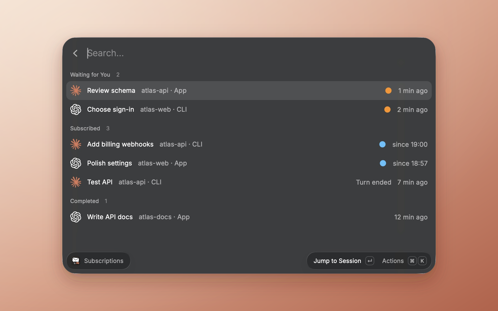
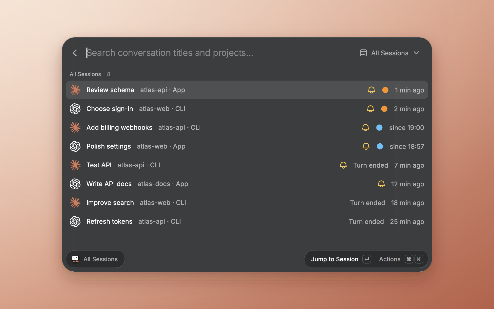
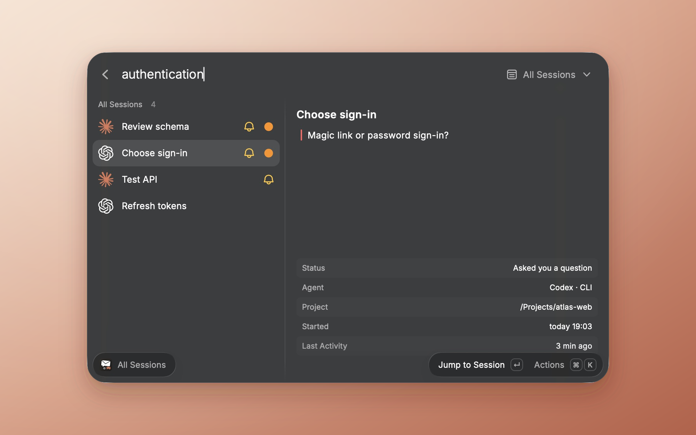

<!-- Proposed upstream title: Add Agent Inbox extension -->
<!-- Local review draft. Before sending upstream, replace the screenshot links below with public URLs from the submission fork. -->

## Description

Agent Inbox is a macOS extension for following existing Claude Code and Codex conversations from Raycast. It provides one opt-in inbox across desktop and terminal sessions, with navigation back to the conversation that needs attention.

The extension adds four commands:

- **Subscribe to Current Conversation** follows the focused conversation and supports a dedicated global hotkey.
- **All Sessions** searches local history by title, project, or session ID. Optional full-text search is disabled by default.
- **Subscriptions** groups conversations by state. Return jumps back, Command-Return toggles a subscription, and Command-D marks a request handled.
- **Session Menu Bar** shows subscribed sessions and the waiting count.

Users connect Claude Code or Codex from the action panel. Connecting installs local hooks and a user LaunchAgent, backing up configuration before editing it. Conversation files are read-only, state stays on the Mac, and the extension does not upload conversations or approve agent requests. Setup, permissions, and removal instructions are included in the README and setup guide.

The extension requires an existing Claude Code or Codex setup. Clickable macOS notifications additionally require `terminal-notifier`. Cloud-only Claude conversations are identified by a cloud icon and support navigation without local status monitoring.

### Validation

- `npm ci`, `npm run check`, and `npm run lint` passed in the prepared `extensions/agent-inbox` checkout; all 152 tests passed without failures or skips.
- The distribution build was exercised in native Raycast. Subscription search, cloud indicators, mark-handled behavior, and unsubscribe behavior were verified.
- The user verified focused subscription and return navigation in Codex desktop and their usual terminal.
- A real Claude Code question and generic reminder produced one pending request; answering cleared it and returned the session to ready.
- **Pending live coverage:** notification delivery and notification-click navigation, because macOS notification permission remains disabled. Terminal, iTerm2, Ghostty, and tmux have not each been independently verified by name. These are not claimed as passed.

## Screencast

These screenshots use fictional sessions and a consistent theme and background. Each image is a 2000 × 1250 PNG. They were captured from the native Raycast window and framed on a uniform background; Capture Window did not export on the validation machine.

## Checklist

- [x] I read the [extension guidelines](https://developers.raycast.com/basics/prepare-an-extension-for-store).
- [x] I read the [documentation about publishing](https://developers.raycast.com/basics/publish-an-extension).
- [x] I ran `npm run build` and tested this distribution build in Raycast.
- [x] I checked that files in the `assets` folder are used by the extension itself.
- [x] I checked that assets used in the README are located outside the metadata folder if they were not generated with the metadata tool.
